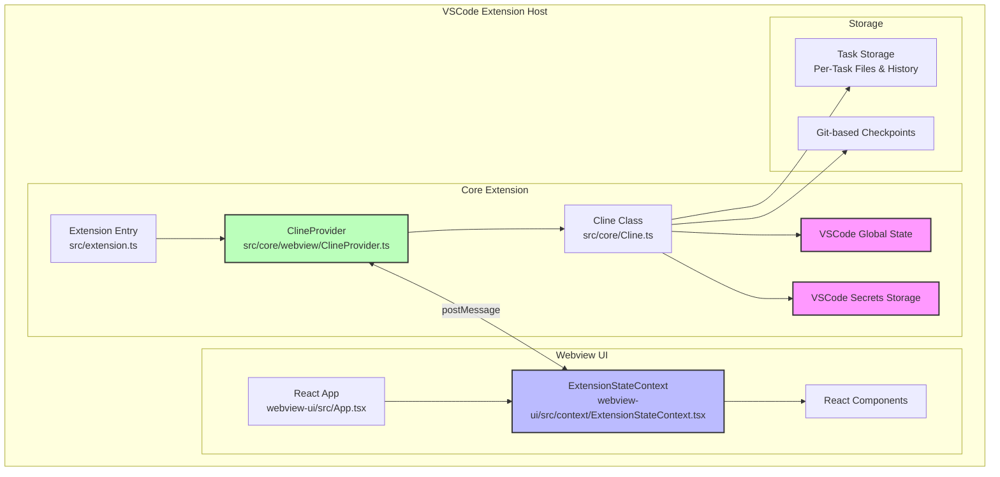

# System Patterns: Cline VSCode Extension Architecture

## Architecture Overview

Cline follows a modular architecture pattern, separating the core extension logic from the webview UI and utilizing VSCode's API for editor integration.

## Key Technical Decisions

- **TypeScript:**  Chosen for the entire extension for type safety, maintainability, and developer productivity.
- **React:** Used for building the webview UI, providing a component-based architecture and efficient UI rendering.
- **VSCode Extension API:** Leveraged extensively for editor integration, file system access, terminal execution, and state management.
- **Model Context Protocol (MCP):**  Adopted for extensibility, allowing users to add custom tools and integrations.
- **Git for Checkpoints:**  Utilized for workspace snapshots and version control, enabling task resumption and rollback.

## Design Patterns

- **Provider Pattern:** `ClineProvider` acts as a central state manager, providing state to both core extension and webview components.
- **Context Pattern:** `ExtensionStateContext` in React provides a way to pass state down the component tree without prop drilling.
- **Modular Architecture:**  Separation of concerns between core extension, webview UI, and integrations for maintainability and scalability.
- **Event-Driven Communication:** VSCode's message passing system used for communication between core extension and webview.

## Component Relationships

- **Extension Entry (src/extension.ts):**  The main entry point for the extension, responsible for extension activation and registration of commands and providers.
- **ClineProvider (src/core/webview/ClineProvider.ts):** Manages the core extension state, handles communication with the webview, and coordinates state updates.
- **Cline Class (src/core/Cline.ts):**  The heart of the extension, responsible for task execution, tool orchestration, and API interactions.
- **Webview UI (webview-ui/):**  The React application that provides the user interface for Cline, displaying messages, tool outputs, and controls.
- **ExtensionStateContext (webview-ui/src/context/ExtensionStateContext.tsx):**  Manages the webview state and provides access to the extension state for React components.
- **Task Storage:**  File-based storage for task-specific data and history, enabling task resumption.
- **Checkpoint System:** Git-based snapshots of the workspace, allowing users to compare and restore previous states.
